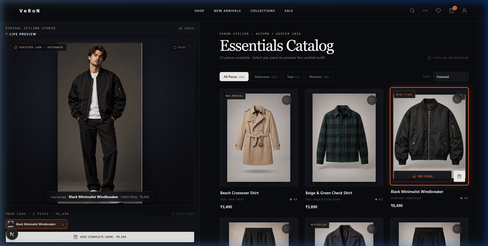
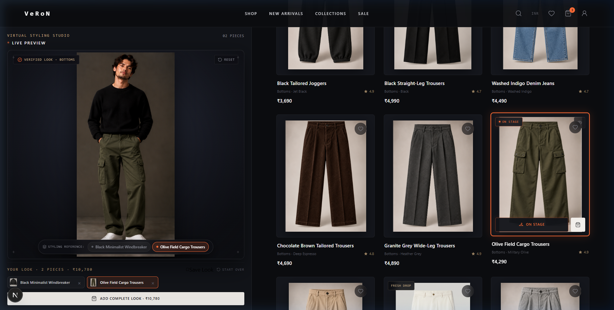
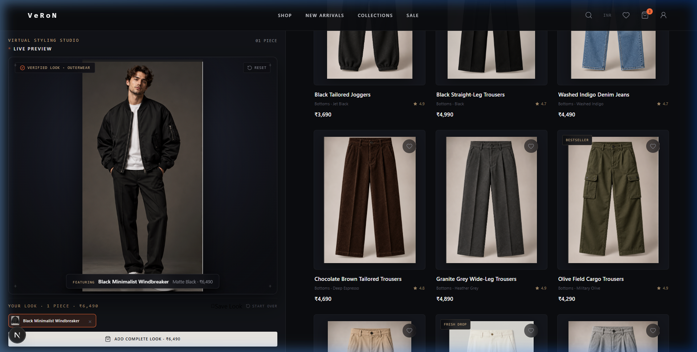
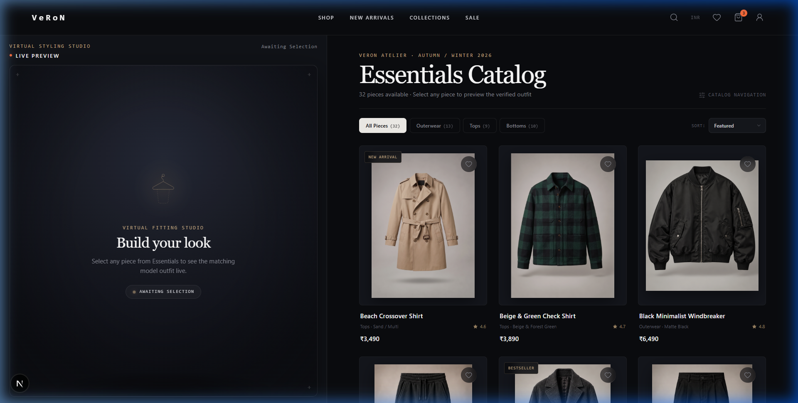
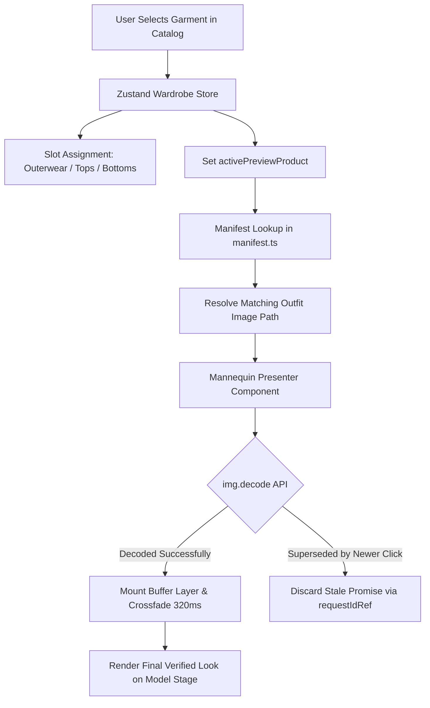

<div align="center">

# VeRoN

**A considered approach to fashion discovery and live virtual styling.**

[](https://nextjs.org/)
[](https://react.dev/)
[](https://www.typescriptlang.org/)
[](https://github.com/pmndrs/zustand)
[](https://www.framer.com/motion/)

<br />



</div>

---

## Overview

**VeRoN** is an e-commerce platform and live virtual styling studio engineered for contemporary fashion discovery. The platform bridges the divide between isolated product packshots and real-world outfit presentation.

Rather than presenting clothes on disembodied hangers or generic mannequin cutouts, VeRoN couples an **Essentials Catalog** with a prominent, real-time **Live Fitting Studio**. When a shopper selects a garment from the catalog, the studio instantly resolves and presents the verified matching model photograph wearing that complete look—rendered with edge-to-edge fidelity, seamless crossfading, and zero loading flicker.

### Key Highlights

- **40 / 60 Balanced Studio Split**: The desktop viewport dedicates ~40% of horizontal real estate to an expansive, sticky model stage and ~60% to a comfortable, non-cramped catalog grid.
- **Double-Buffered Zero-Flicker Presenter**: Incoming photography is pre-decoded in memory (`HTMLImageElement.decode()`) before crossfading, eliminating blank frames and flash-of-white artifacts.
- **Immediate Selection Feedback**: Product cards activate in 150ms with subtle gold badging and borders, superseding heavy full-screen blocking animations.
- **Race Condition Immunity**: Rapid multi-clicking is gracefully handled through asynchronous request cancellation tokens (`requestIdRef`), guaranteeing the visible outfit always corresponds to the user's latest choice.
- **Multi-Piece Coordination**: Shoppers can combine outerwear, tops, and bottoms, dynamically switching styling reference previews and inspecting their complete look breakdown.
- **1:1 Verified Asset Manifest**: 32 distinct garment packshots rigorously paired with corresponding verified model outfit photographs via an automated test suite.

---

## Table of Contents

- [Visual Showcase](#visual-showcase)
- [Architecture & Engineering](#architecture--engineering)
- [Interactive Features](#interactive-features)
- [Asset Organization & Manifest](#asset-organization--manifest)
- [Technology Stack](#technology-stack)
- [Project Structure](#project-structure)
- [Getting Started](#getting-started)
- [Available Scripts](#available-scripts)
- [Routes & Pages](#routes--pages)
- [Contributing](#contributing)
- [License](#license)

---

## Visual Showcase

### 1. The Live Fitting Studio
The model stage commands primary visual attention. Inner padding has been reduced to allow the model photography to utilize 98% of the viewport height, preserving complete outfits from headwear to footwear.

<div align="center">
  
  <p><em>The expanded live fitting studio featuring the Black Minimalist Windbreaker with instant look metadata.</em></p>
</div>

---

### 2. Multi-Piece Look Coordination
Selecting garments across multiple categories (e.g., combining an outerwear jacket with tailored cargo trousers) populates active look chips. Interactive styling reference tabs (`[Outerwear]`, `[Bottoms]`) allow the user to alternate the model stage focus between their selected pieces.

<div align="center">
  
  <p><em>Multi-piece coordination pairing the Windbreaker with Olive Cargo Trousers.</em></p>
</div>

---

### 3. Essentials Catalog & Category Filtering
The Essentials catalog features category filters with real-time inventory tallies, clear typography, and responsive grid layouts. Individual clothing photography is preserved with natural aspect ratios.

<div align="center">
  
  <p><em>Filtered catalog view displaying Bottoms with on-stage active indicators.</em></p>
</div>

---

### 4. Editorial Initial Studio
Upon first visiting the studio, an uncluttered empty state welcomes the user to begin curating their personal look.

<div align="center">
  
  <p><em>Pristine initial studio state awaiting first garment selection.</em></p>
</div>

---

## Architecture & Engineering

### Data Flow Pipeline

The fitting studio operates on a reactive, unidirectional data flow that separates catalog browsing, selection state, asset resolution, and rendering buffers:



### Key Technical Implementations

#### 1. Double-Buffered Zero-Flicker Transitions
Standard image transitions often flash blank backgrounds or layout-shift while the browser fetches and paints high-resolution photography. VeRoN solves this by holding the current outfit in an `active` DOM layer while asynchronously loading and decoding the `incoming` image in memory:

```typescript
// Asynchronous pre-decode pattern in Mannequin.tsx
const img = new Image();
img.src = resolvedOutfitPath;

if ('decode' in img) {
  await img.decode();
}

// Cancel if user clicked another item while decoding
if (currentRequestId !== requestIdRef.current) return;

// Commit to DOM and trigger 320ms crossfade
setLayers({ active: resolvedOutfitPath, incoming: null });
```

#### 2. Sticky Proportions Without Scroll-Hijacking
The shop layout utilizes a CSS Grid container with sticky sidebar alignment:
- Left Column (`.shop-stage-column`): `minmax(430px, 40vw)` sticky container (`top: 88px; height: calc(100vh - 104px)`).
- Right Column (`.shop-catalog-column`): Flexible `1fr` catalog that scrolls with native browser physics.
- Prevents awkward nested scrollbars and maintains desktop viewability across large screens.

---

## Interactive Features

| Feature | Interaction | Engineering Mechanism |
|:---|:---|:---|
| **Garment Selection** | Click any product card | Instant `onTryOn` dispatch, 150ms border highlight, gold `ON STAGE` badge |
| **Model Crossfade** | Automatic on selection | Double-buffered memory decode + 320ms GPU opacity transition |
| **Rapid Clicking** | Click multiple products quickly | `requestIdRef` cancellation token discards stale image decode promises |
| **Multi-Piece Slots** | Select items across categories | Wardrobe store assigns to `outerwear`, `tops`, or `bottoms` slots |
| **Styling Preview Switch** | Click category pill below model | Changes `activePreviewProduct` to highlight corresponding piece |
| **Category Filtering** | Click All, Outerwear, Tops, Bottoms | Client-side reactive filter with exact product counts |
| **Quick View Modal** | Click packshot image | Accessible dialog overlay with detailed specs and sizing |
| **Reset Look** | Click `Clear` button in studio | Clears all slots and transitions model stage back to initial state |
| **Cart & Wishlist** | Add to Bag / Save Favorite | Persistent Zustand stores with slide-over Cart Drawer |

---

## Asset Organization & Manifest

VeRoN utilizes genuine, high-resolution clothing and model photography stored in `public/images/`:

```
public/images/
├── Essentials/         # 32 individual garment packshots
│   ├── Black Jacket.png
│   ├── Olive  Cergo Pant.png
│   ├── Beach CrossOver.png
│   └── ...
└── Outfit/             # 32 verified matching model photographs
    ├── Black jacket Outfit.png
    ├── Olive  Cergo Pant Outfit.png
    ├── Beach CrossOver Outfit.png
    └── ...
```

### The 1:1 Manifest Registry (`data/manifest.ts`)
Each product entry explicitly binds an Essentials packshot to its verified Outfit photograph:

```typescript
{
  id: "veron-3",
  name: "Black Minimalist Windbreaker",
  category: "outerwear",
  price: 6499,
  essentialsImage: "/images/Essentials/Black Jacket.png",
  outfitImage: "/images/Outfit/Black jacket Outfit.png",
  description: "Matte-finish technical windbreaker with storm cuffs..."
}
```

### Automated Manifest Integrity Suite
To prevent broken asset paths or naming mismatches, an automated verification script runs against the physical filesystem:

```bash
node scripts/test-manifest.js
```

```
====================================================
   VeRoN VIRTUAL STYLING STUDIO — ASSET INTEGRITY TEST
====================================================
Found 32 product entries in asset manifest.
TEST RESULTS: 32 PASSED, 0 FAILED out of 32 pairs.
ALL 32 ASSETS VERIFIED WITH 100% 1:1 REPO INTEGRITY!
```

---

## Technology Stack

### Core Framework & Runtime
- **Next.js 16.3.3**: React framework utilizing App Router architecture and Turbopack.
- **React 19.2.8**: Component architecture and modern hooks (`useRef`, `useCallback`, `useMemo`).
- **TypeScript 6.0.3**: Strict end-to-end type safety across stores, manifests, and component interfaces.

### State & Animation
- **Zustand 5.0.15**: Lightweight, decoupled state management with local storage persistence (`veron-wardrobe-v1`).
- **Framer Motion 13.1.1**: Motion primitives and spring animations for micro-interactions and modals.
- **Lucide React 1.37.0**: Crisp, modern icon set.

### Styling System
- **Vanilla CSS Tokens & Modules**: Custom CSS design system located in `app/globals.css` and `app/overrides.css`, utilizing HSL color variables, refined dark mode aesthetics, and glassmorphism.

---

## Project Structure

```
VeRoNx2/
├── app/
│   ├── globals.css                # Core design tokens, typography, utilities
│   ├── overrides.css              # 40/60 studio grid, stage dimensions, responsive rules
│   ├── layout.tsx                 # Root layout with Header, CartDrawer, and Footer
│   ├── page.tsx                   # Storefront landing page & hero campaign
│   ├── shop/                      # Live Fitting Studio & Essentials Catalog
│   │   └── page.tsx
│   ├── product/[slug]/            # Individual product detail pages
│   ├── look/[id]/                 # Curated editorial look view
│   ├── cart/ & checkout/          # Shopping bag and checkout overview
│   └── wishlist/ & account/       # Customer wishlist and account views
├── components/
│   ├── fitting-room/
│   │   ├── FittingRoom.tsx        # Studio stage frame, look summary, styling tabs
│   │   └── Mannequin.tsx          # Double-buffered presenter with pre-decoding
│   ├── products/
│   │   ├── ProductCard.tsx        # Garment card with instant selection feedback
│   │   ├── ProductGrid.tsx        # Responsive catalog grid container
│   │   └── QuickViewModal.tsx     # Detailed product inspection modal
│   └── layout/
│       ├── Header.tsx             # Primary navigation & VeRoN branding
│       ├── Footer.tsx             # Storefront footer with links & newsletter
│       └── CartDrawer.tsx         # Slide-over shopping bag drawer
├── data/
│   ├── manifest.ts                # 1:1 product-to-outfit asset mapping registry
│   └── products.ts                # 32-piece product catalog specifications
├── store/
│   ├── wardrobeStore.ts           # Fitting room slot state & active preview
│   ├── cartStore.ts               # Shopping cart state & quantity management
│   └── wishlistStore.ts           # Saved favorites state
├── scripts/
│   └── test-manifest.js           # Automated asset verification script
└── docs/
    └── images/                    # Verified screenshot captures for documentation
```

---

## Getting Started

### Prerequisites
- **Node.js**: `v18.18.0` or higher (Node 20+ recommended)
- **Package Manager**: `npm` (v9 or v10)

### Installation

1. **Clone the repository**:
   ```bash
   git clone https://github.com/kausikhussain/VeRoNx2.git
   cd VeRoNx2
   ```

2. **Install dependencies**:
   ```bash
   npm install
   ```

3. **Verify asset manifest integrity**:
   ```bash
   node scripts/test-manifest.js
   ```

4. **Start the local development server**:
   ```bash
   npm run dev
   ```

5. Open [http://localhost:3000](http://localhost:3000) in your browser to explore the live experience.

---

## Available Scripts

| Command | Purpose |
|:---|:---|
| `npm run dev` | Starts the Next.js development server with hot module replacement |
| `npm run build` | Compiles an optimized production build of the Next.js application |
| `npm run typecheck` | Executes `tsc --noEmit` to validate strict TypeScript types |
| `npm run lint` | Runs ESLint across all pages and components |
| `node scripts/test-manifest.js` | Audits all 32 Essentials-to-Outfit image pairs on disk |

---

## Routes & Pages

- **`/`**: Editorial landing page with hero campaigns, category spotlights, and featured essentials.
- **`/shop`**: The primary **Live Fitting Studio** experience with the enlarged model stage and interactive catalog.
- **`/product/[slug]`**: Dedicated product view with high-res imagery, sizing options, and direct "Try in Studio" action.
- **`/look/[id]`**: Editorial lookbook presenting coordinated outfits.
- **`/cart`**: Complete shopping bag review.
- **`/checkout`**: Order review and address entry flow.
- **`/wishlist`**: Customer favorite garments collection.
- **`/account`**: User profile and order history placeholder.

---

## Contributing

Contributions, bug reports, and suggestions are welcome.

1. **Fork the repository** on GitHub.
2. **Create a feature branch**:
   ```bash
   git checkout -b feature/your-feature-name
   ```
3. **Commit your modifications** using concise conventional commit messages:
   ```bash
   git commit -m "feat(studio): add new camera framing control"
   ```
4. **Validate TypeScript and tests**:
   ```bash
   npm run typecheck
   node scripts/test-manifest.js
   ```
5. **Push to your branch and open a Pull Request**:
   ```bash
   git push origin feature/your-feature-name
   ```

---

## License

The license for this repository has not yet been specified. All rights to imagery, branding, and proprietary assets are reserved by the repository owner.
